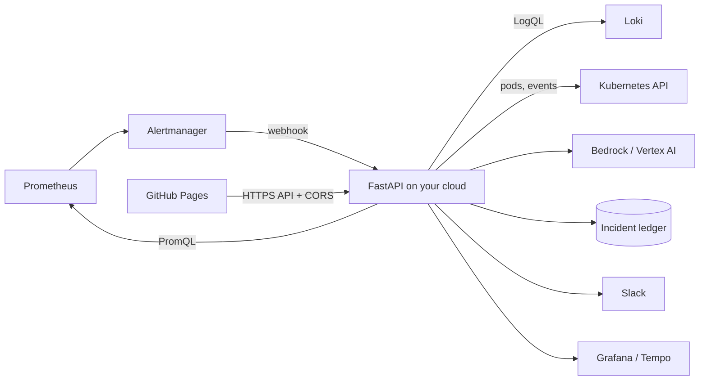

[](https://github.com/sunkaradp/alertscope/actions/workflows/ci.yml)

# AlertScope

Alertmanager webhook that does the first look at an alert for you. It pulls the
metrics, logs and pod events around the alert, asks an LLM what's going on, and posts
the answer to Slack.

I'm on call for a Kubernetes setup at work and most alerts start the same way:
open Grafana, find the pod, check restarts and memory, grep Loki, `kubectl describe`.
I wanted that part done before I even open my laptop.

## Public website

The static product website and browser-based incident console are published with
GitHub Pages at **https://sunkaradp.github.io/alertscope/** after the Pages
deployment workflow runs on `main`. The website itself is static; it does not host
the FastAPI service, database, Prometheus, Grafana, Loki or the LLM provider.

To connect the public console to a deployed API:

1. Deploy the FastAPI service on infrastructure you control and expose it over HTTPS.
2. Set `ALERTSCOPE_CORS_ORIGINS=["https://sunkaradp.github.io"]` in the backend environment
   (or configure the exact custom Pages domain you use).
3. Open the Pages website, enter the API base URL and optional bearer token, then connect.
4. Keep the API token private. The console keeps it in the current browser session only.

The console polls the API every 15 seconds and reads the actual `/readyz` and
`/incidents` endpoints. When the backend is not configured or reachable, it shows
a disconnected state rather than sample incident records. GitHub Pages is only
the frontend; it is not a production SaaS backend.

## Architecture



## What it does per alert

- runs the alert's own expression again (taken from `generatorURL`) for the last 15 min
- if the alert has a `pod` label: restarts, memory vs limit, CPU, last termination reason
- error lines + latest lines for that pod from Loki (repeated lines get collapsed)
- pod status and events from the k8s API
- sends that to Claude on Bedrock or Gemini on Vertex and asks for cause, evidence,
  next steps and a confidence level (JSON)
- Slack message + one JSON log line per analysis, which the Grafana dashboard reads

Same alert fingerprint is skipped for 30 min. If Prometheus, Loki or the LLM fails it
still posts whatever it has.

## Run it locally

Needs Docker. Starts a small service that breaks on purpose (`demo/breaker`) plus
Prometheus, Alertmanager, Loki, Alloy, Grafana and alertscope.

```bash
cp .env.example .env
make up
make break MODE=leak      # errors | slow | leak | crash
# wait a minute, then http://localhost:3000/d/alertscope
make fix
```

Use `make down` to stop the stack without deleting incident/trace volumes. Use
`make clean` only when you intentionally want to delete the persisted local data.

AlertScope console: http://localhost:8080 (incident list, analysis details,
acknowledge and resolve actions). Grafana: http://localhost:3000/d/alertscope
(user admin; password is GRAFANA_ADMIN_PASSWORD from .env, defaulting to
local-alertscope-password for this localhost-only demo). The other demo endpoints
are bound to 127.0.0.1.

`make fire` sends a fake alert straight to the webhook if you don't want to wait.

Default LLM is `stub`, which is just a few regexes so you can run it without any cloud
account. Set `ALERTSCOPE_LLM_PROVIDER=bedrock` or `vertex` in `.env` for the real thing.

## Live SRE telemetry

The Grafana dashboard refreshes every 15 seconds and includes two distinct views:
AlertScope's own incident-analysis metrics and infrastructure telemetry queried
directly from Prometheus. The local Compose stack scrapes:

- **node-exporter** for host CPU, memory, filesystem and network.
- **cAdvisor** for container CPU and memory.
- **AlertScope** for webhook, collector, LLM and analysis metrics.
- **The breaker** for the demo service's application metrics.

For a Kubernetes deployment, the node and pod panels also expect node-exporter,
kubelet/cAdvisor and kube-state-metrics to be scraped by the Prometheus datasource.
The Kubernetes panels deliberately show **No data** if those sources are absent.
A 15-second Grafana refresh does not make the underlying scrape interval faster.

### Webhook protection, CORS and overload behaviour

Set `ALERTSCOPE_WEBHOOK_TOKEN` to require an Authorization: Bearer <token> header
on the Alertmanager webhook. For Kubernetes, create a Secret containing the
`ALERTSCOPE_WEBHOOK_TOKEN` key and set `webhook.existingSecret` in the chart values;
configure the Alertmanager receiver to send the matching bearer token. Leave auth
unset only in a trusted local network. The service caps in-flight analysis tasks
with `ALERTSCOPE_MAX_PENDING_TASKS` (default 100); when the cap is reached it responds
with HTTP 503 so Alertmanager can retry. Tune Alertmanager retry and grouping behaviour.

The Pages console is a separate browser origin. The backend allows the official
`https://sunkaradp.github.io` origin by default. Set `ALERTSCOPE_CORS_ORIGINS` to a
JSON array of exact trusted origins for a custom domain. Do not use wildcard CORS
with bearer-token access. Use HTTPS for the public API and protect the API with
`ALERTSCOPE_WEBHOOK_TOKEN`.

The default stub provider is deterministic demo logic, not an LLM. Set the
provider to bedrock or vertex and configure its cloud identity before describing
an analysis as AI-generated. AlertScope never invents telemetry: unavailable sources
remain unavailable and low-evidence conclusions should stay low confidence.

## Deploy

Cluster is GKE, the LLM is Claude on Bedrock. The pod talks to AWS without access keys:
AWS IAM trusts the GKE cluster as an OIDC provider, the pod gets a service account
token with audience `sts.amazonaws.com`, and boto3 swaps it for a role via
`AssumeRoleWithWebIdentity`. The role only accepts the `alertscope/alertscope`
service account. GitHub Actions pushes images to Artifact Registry the same way
(Workload Identity Federation), so no keys in repo secrets either.

```bash
# GCP: VPC, GKE, Artifact Registry, Workload Identity
cd infra/gcp
cp terraform.tfvars.example terraform.tfvars
terraform init -backend-config="bucket=<project>-tfstate"
terraform apply

# AWS: OIDC provider for the cluster, Bedrock role, budget alert
cd ../aws
cp terraform.tfvars.example terraform.tfvars   # cluster_oidc_issuer from the gcp output
terraform init -backend-config="bucket=<bucket>" -backend-config="region=eu-central-1"
terraform apply

# Argo CD, then it pulls everything else from gitops/
$(terraform -chdir=../gcp output -raw get_credentials)
kubectl create ns argocd
kubectl apply -n argocd --server-side -f https://raw.githubusercontent.com/argoproj/argo-cd/stable/manifests/install.yaml
kubectl create ns alertscope
kubectl -n alertscope create secret generic alertscope-slack --from-literal=SLACK_WEBHOOK_URL=...
# Optional: set webhook.existingSecret: alertscope-webhook in gitops/values/alertscope.yaml
kubectl -n alertscope create secret generic alertscope-webhook --from-literal=ALERTSCOPE_WEBHOOK_TOKEN="$(openssl rand -hex 32)"
kubectl apply -f gitops/root.yaml
```

Before that, put your `PROJECT_ID` and `AWS_ACCOUNT_ID` into `gitops/values/`, and set
the repo variables `GCP_WIF_PROVIDER`, `GCP_CI_SA`, `REGISTRY` from the terraform
outputs. Every push to `main` that touches `app/` or `demo/` builds the images,
bumps the tag in `gitops/values/` and Argo CD deploys it.

You have to enable Anthropic model access in the Bedrock console once.
For Gemini instead: `config.llm.provider: vertex` + `config.vertex.project`.

Cost: 2x `e2-standard-2` spot nodes is around $30-45/month, Bedrock with Haiku is
well under a cent per alert. I scale the node pool to 0 when I'm not using it:

```bash
gcloud container clusters resize alertscope --node-pool default --num-nodes 0 --zone europe-west3-a
```

## Grafana / metrics

Grafana provides the infrastructure/telemetry dashboards; the AlertScope console
provides incident workflow and investigation details. The chart ships the dashboard
as a ConfigMap (`charts/alertscope/dashboards/alertscope.json`) and the
kube-prometheus-stack sidecar loads it. Analyses are just log lines:

```logql
{container="alertscope"} | json | event="analysis" | confidence="high"
```

Prometheus metrics on `/metrics/`:

- `alertscope_alerts_received_total`, `alertscope_alerts_skipped_total{reason}`
- `alertscope_analyses_total{result,confidence}`
- `alertscope_analysis_seconds`, `alertscope_llm_seconds{provider}`
- `alertscope_llm_tokens_total{provider,direction}`
- `alertscope_collector_errors_total{collector}`

## Incident lifecycle and tracing

Analyses are stored in SQLite. The app defaults to `/tmp/alertscope.db` for a
simple local process; the local Compose stack and Helm deployment explicitly use
`/data/alertscope.db` on a named volume/PVC. The Helm chart provisions a 5Gi PVC by default. Keep one
replica while using this SQLite backend. Back up the PVC before upgrades or
cluster changes; for multi-replica/high-write deployments, move this ledger to
PostgreSQL rather than sharing SQLite over a network filesystem.

Incident API:

```bash
curl http://localhost:8080/incidents
curl http://localhost:8080/incidents/<incident-id>
curl -X POST http://localhost:8080/incidents/<incident-id>/acknowledge
curl -X POST http://localhost:8080/incidents/<incident-id>/resolve
```

When `ALERTSCOPE_WEBHOOK_TOKEN` is set, include the same
`Authorization: Bearer <token>` header on incident API calls as well as the
Alertmanager webhook. A new analysis for a previously resolved fingerprint
reopens that incident.

Local tracing is exported to Tempo over OTLP/HTTP. Open Grafana Explore, select
the Tempo datasource, and search for service `alertscope`. The app instruments
FastAPI requests and outbound HTTPX calls. For Kubernetes, add
`OTEL_EXPORTER_OTLP_ENDPOINT` and `OTEL_SERVICE_NAME` through `extraEnv`, and
point the endpoint at your in-cluster Tempo/OTel Collector service. Tracing is
disabled when no OTLP endpoint is configured.

## Config

Environment variables use the `ALERTSCOPE_` prefix (see
[config.py](app/src/alertscope/config.py)). Main ones: `LLM_PROVIDER`,
`BEDROCK_MODEL_ID`, `VERTEX_MODEL`, `LOOKBACK_MINUTES`, `COOLDOWN_MINUTES`,
`LOKI_LABELS`, `KUBE_ENABLED`, `SLACK_WEBHOOK_URL`, `WEBHOOK_TOKEN`,
`CORS_ORIGINS`, `MAX_PENDING_TASKS` and `DATABASE_PATH`.
The service exposes `/healthz` for liveness, `/readyz` for readiness,
`/metrics/` for Prometheus, and `/incidents` for the persistent incident API.

## Repository layout

```
app/            the service + tests
docs/           public GitHub Pages website and browser console
demo/breaker/   service that fails on demand
charts/         helm charts + Grafana dashboard
deploy/local/   docker compose
infra/gcp/      GKE, registry, workload identity
infra/aws/      OIDC trust + Bedrock role
gitops/         argo cd apps
```

## TODO

- [ ] measure how often it gets the cause right (run each breaker mode ~10x, compare models)
- [ ] let the model ask for more queries (tool calling) instead of one prompt
- [ ] Tempo traces as another collector
- [ ] remember past incidents and their fix, show similar ones
- [ ] it's read-only on purpose, maybe later: suggest a rollback with a button in Slack
